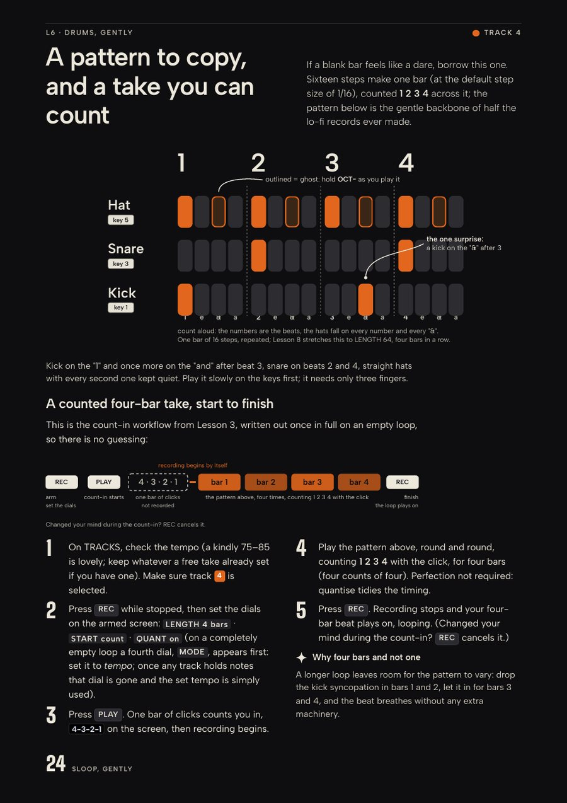
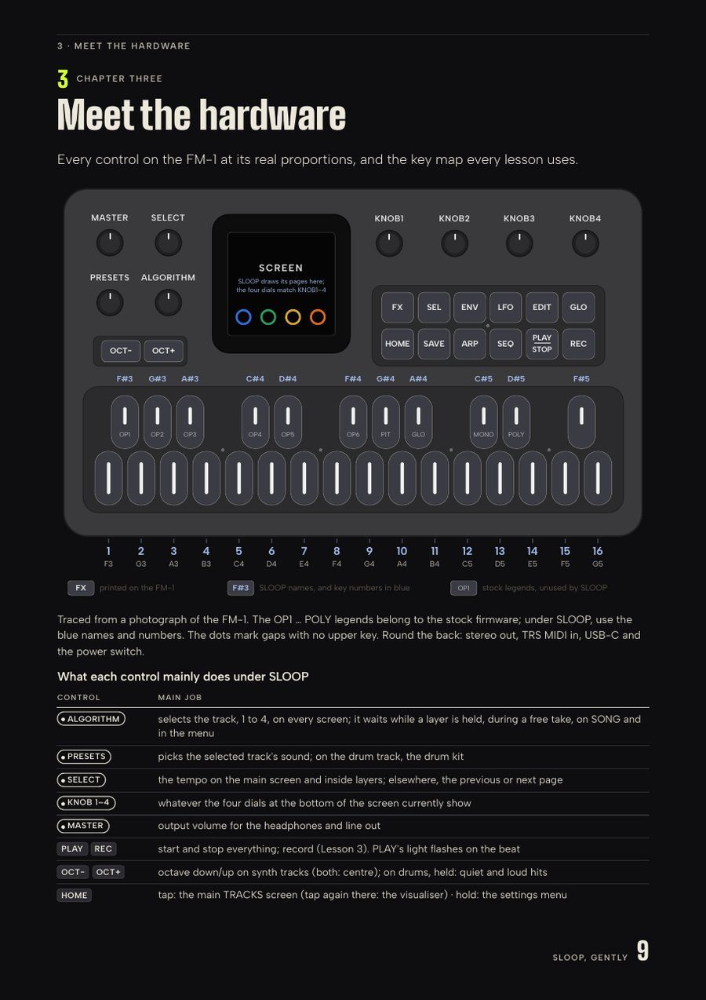

# SLOOP, Gently

**Atmospheres first, drums later.**

*A free, illustrated beginner's handbook for SLOOP on the M-VAVE FM-1.*

Not a technical encyclopaedia. Not a music-theory course. Just a friendly, visual introduction to making atmospheric electronic music, grooves, basslines and melodies on an inexpensive little synthesiser.

No prior synthesis knowledge required.

---

## Download the handbook

| Edition | Best for | Size | Download |
| --- | --- | --- | --- |
| **A4** | Desktop reading and A4 printing | 44 pages | [**Download the A4 PDF**](https://github.com/suprsomething/sloop-gently/releases/download/v0.9.0-preview/SLOOP-Gently-A4.pdf) |
| **iPad mini** | Portrait reading on the 8.3-inch iPad mini | 114 screens | [**Download the iPad mini PDF**](https://github.com/suprsomething/sloop-gently/releases/download/v0.9.0-preview/SLOOP-Gently-iPad-Mini.pdf) |

Both editions contain the same lessons. Only the layout changes, so pick whichever suits the screen (or the printer) you have.

**Handbook:** v0.9 Preview · **Firmware documented:** SLOOP 2.8.4 · **Status:** pre-release, awaiting real-hardware testing

Future versions will appear on the [Releases page](https://github.com/suprsomething/sloop-gently/releases).

> **A note on this preview.** Every instruction was checked carefully against the official SLOOP 2.8.4 documentation, but the lessons have not yet been worked through one by one on a physical FM-1. If something on your unit behaves differently from the book, please [tell us](#corrections-and-feedback) so the next version can fix it.

---

## A look inside

  

  
  &nbsp;
  

A dark, quiet design for late-night sessions · a drum pattern you can copy with three fingers · every FM-1 control at its real proportions.

---

## What you'll learn

The book moves slowly, one small win at a time:

1. Find beautiful sounds and create atmospheric textures.
2. Shape sounds with envelopes, filters and movement.
3. Record and layer loops.
4. Add drums, bass and melodies.
5. Understand the basic step sequencer.
6. Perform simple arrangements and save your creations.

Advanced synthesis techniques are deliberately left out. When you are ready for them, the book points you to the official SLOOP guide.

## Who it's for

- Complete beginners.
- Casual electronic musicians.
- FM-1 owners exploring SLOOP for the first time.
- Anyone who wants a gentle start without a DAW or a pile of music theory.

---

## About SLOOP

[SLOOP](https://github.com/isod89/sloop-fm1) is an independent, open-source groovebox firmware for the M-VAVE FM-1, created by **isod89** and built on [Felucca](https://github.com/hugelton/Felucca) by **Leo Kuroshita** (Hügelton Instruments).

- [Official SLOOP repository](https://github.com/isod89/sloop-fm1)
- [SLOOP 2.8.4 guide (version-pinned)](https://github.com/isod89/sloop-fm1/blob/v2.8.4/GUIDE.md)
- [Official SLOOP releases and release notes](https://github.com/isod89/sloop-fm1/releases)
- [SLOOP installer](https://isod89.github.io/sloop-fm1/)

Please install and update SLOOP using the official installer and release notes, not this handbook.

*SLOOP, Gently* is an unofficial community publication. It is not made, endorsed or supported by M-VAVE, by the SLOOP developers or by Hügelton Instruments.

---

## Version compatibility

The handbook has its own version number, separate from the firmware it describes. "v0.9 Preview" is the version of this book; "SLOOP 2.8.4" is the firmware it was written for.

| | Status |
| --- | --- |
| Handbook | v0.9 Preview |
| Documented firmware | SLOOP 2.8.4 |
| Hardware testing | Pending |
| Newer firmware | Consult the [official release notes](https://github.com/isod89/sloop-fm1/releases) |

SLOOP 2.8.5 added support for an additional FM-1 flash-chip variant. If you have a newer unit, or a newer SLOOP version, follow the [official release notes](https://github.com/isod89/sloop-fm1/releases) for installing and updating. This handbook documents SLOOP 2.8.4 only.

---

## Corrections and feedback

Spotted a wrong button combination, an unclear step, a diagram mistake or something that behaves differently on your FM-1? Please [open an issue](https://github.com/suprsomething/sloop-gently/issues/new/choose). There are two short forms:

- **Technical correction:** something in the book does not match what SLOOP actually does.
- **Documentation or design improvement:** something could be clearer, kinder or easier to read.

No question is too small, and beginners' reports are especially welcome: you are exactly who the book is for.

---

## Credits and licences

- **SLOOP** by isod89, and **Felucca** by Leo Kuroshita / Hügelton Instruments, together with their contributors. The SLOOP screen and web-editor images that appear in the handbook come from the official SLOOP repository and remain the work of their creators.
- Typeset in **Albert Sans** and **Big Shoulders Display** (SIL Open Font License 1.1).
- The handbook was developed with AI-assisted writing, coding and layout, and went through repeated rounds of independent review against the official documentation.

Full details, including what you may reuse and how: [CREDITS.md](CREDITS.md) and [LICENSE.md](LICENSE.md).

"M-VAVE" and "FM-1" are trademarks of their respective owners. They are used here only to describe the hardware.
